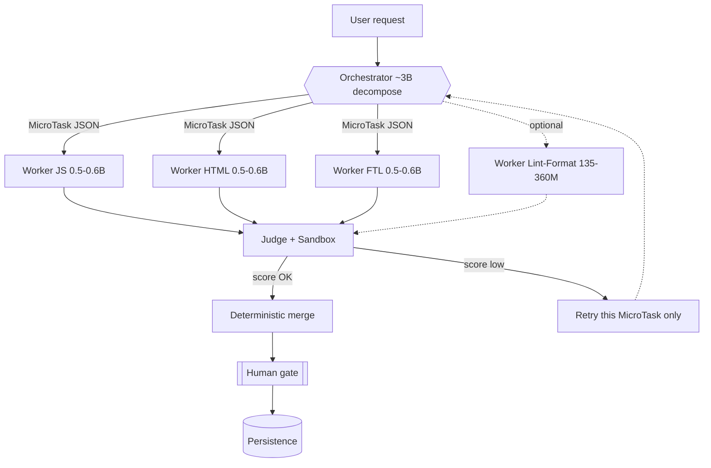

# Nano-Orchestrator — Execution Plan (README-as-Spec)

> **Status:** **stopped (negative on GATE-001)** — keep solo `Qwen2.5-Coder-0.5B` · **Location:** `nano-orchestrator/` (tracked in repo)  
> **Complements:** `docs/adr/ADR-002-student-model-selection.md`, UC-004, `docs/EVALUATION-METHOD.md`  
> **Hardware target:** RTX 4060 laptop, **8 GB VRAM**  
> **Local runtime (gitignored):** `.local/models/`, `.local/llama-prism-cuda/`, `.local/bonsai-chat/`  
> **Rules loaded:** AGENT-CORE-PRINCIPLES, token-economy, anti-hallucination, OWASP-AGENTIC-2026 (ASI02 / ASI07 / ASI08)  
> **Gate note:** see [`docs/NEGATIVE-RESULT.md`](docs/NEGATIVE-RESULT.md) (2026-07-21)

This README is the **normative spec** for the subproject. Code that contradicts this file is wrong until the README is updated first.

**Live tracker:** [PROGRESS.yaml](PROGRESS.yaml) — update after every work session.  
**Task backlog (100%):** [TASKS.md](TASKS.md) — all P0–P4 + GATE + EX done; research closed via GATE-NEG.

**Index:** [TASKS](TASKS.md) · 0 TL;DR · 1 Context · 2 Architecture · 3 Contracts · 4 Stack · 5 Layout · 6 Phases · 7 14-day MVP · 8 Anti-patterns · 9 Metrics · 10 Risks · 11 Immediate next steps · 12 How to run · 13 References

---

## 0. TL;DR and Success Criterion

**Goal:** a 100% local codegen agent — no paid API, no network dependency at inference time — specialized in **JavaScript / HTML / FreeMarker** (nano-coder scope), faster and lighter in VRAM than one larger model alone, without losing quality on typed micro-tasks.

**Non-goal:** open-ended coding vs Claude / GPT / Copilot. Out of scope.

**Project success (beyond MVP):**

> Orchestration (**Orchestrator ~3B + Workers &lt;1B + Judge**) MUST beat **solo `Qwen2.5-Coder-0.5B`** on the same 30–50 micro-task gold set:
>
> | Metric | Gate |
> |--------|------|
> | Pass@1 (overall) | ≥ solo baseline |
> | Latency p50 (simple micro-task) | ≤ target measured in Phase 1 (initial reference: **≤ 2000 ms**) |
> | Resident VRAM peak | **≤ 6000 MB** (~2 GB left for OS / Cursor / IDE) |

If orchestration fails this bar → **keep solo 0.5B**. Do not add complexity.

---

## 1. Context (decided — do not reopen)

| Decision | Binding choice |
|----------|----------------|
| Topology | Orchestrator → Workers → Judge/Gate |
| Workers | Specialized `StudentModel` per `TargetLanguage` (ADR-002) |
| Orchestrator / Judge layer | **Application only** — never Domain |
| Persist generated code | **Human gate required** |
| Worker training data | Teacher distillation + Judge-approved logs |
| Every LLM call | Structured log (prompt, response, latency, verdict) |

Local stack already present (reuse — do not reinvent):

| Asset | Path |
|-------|------|
| llama-server (CUDA) | `.local/llama-prism-cuda/llama-server` |
| Qwen2.5-Coder-0.5B GGUF | `.local/models/qwen25-coder-0.5b/` (see bonsai-chat `models.json`) |
| Chat UI / model switcher | `.local/bonsai-chat/` |
| Quality bar for gold code | [`docs/CODE-QUALITY-STANDARD.md`](docs/CODE-QUALITY-STANDARD.md) |

---

## 2. Architecture



**Hard caps (ASI08):**

- Max **5** concurrent workers
- Max **2** retries per `MicroTask`
- Max **2–3** models resident in VRAM at once
- Orchestrator loaded **twice per cycle** only (decompose + judge/merge) — unload between via `keep_alive` / stop server

---

## 3. Contracts (Phase 0) — highest leverage deliverable

### 3.1 Pydantic schemas

Canonical implementation: [`src/nano_orchestrator/domain/entities.py`](src/nano_orchestrator/domain/entities.py)

```text
MicroTask      → id, role, language, prompt, context?, constraints[], acceptance[], max_tokens
WorkerResponse → task_id, code, confidence, notes?, latency_ms, tokens_used
JudgeVerdict   → task_id, passed, score, checks{}, retry_recommended, feedback?
```

Enums: `TargetLanguage` = `javascript | html | freemarker` · `WorkerRole` = `coder | formatter | linter`

### 3.2 Judge rubric (priority — non-negotiable)

1. **Sandbox / execution** (highest weight): real parser, syntax check, tests  
2. **Contract adherence**: valid schema, correct language, within `max_tokens`  
3. **LLM-as-judge** (lowest weight): secondary signal only — never sole decider  

### 3.3 Result-like boundaries

Domain/application boundaries use `Ok` / `Err` ([`domain/result.py`](src/nano_orchestrator/domain/result.py)). Untamed exceptions MUST NOT cross from infrastructure into application.

### 3.4 Phase 0 acceptance tests

```gherkin
GIVEN MicroTask schema
WHEN instance created with language="python"
THEN validation rejects with clear error
AND exception does not leak past the application boundary
```

```bash
cd nano-orchestrator
python -m pytest tests/unit/test_entities.py -q
python scripts/validate_schema.py
```

---

## 4. Technical Stack

| Layer | Choice | Why |
|-------|--------|-----|
| Primary LLM runtime | **llama.cpp server** (already in `.local/llama-prism-cuda`) | GPU offload `-ngl 99`, matches bonsai-chat |
| Optional alternate | Ollama (`keep_alive`) | Faster pull for bake-off; same GGUF family |
| Language | Python 3.11+ | Aligns with nano-coder train / Unsloth path |
| Contracts | Pydantic v2 | Schema tests already scaffolded |
| Fine-tune (Phase 3) | HF PEFT QLoRA (Unsloth optional) | Proven on RTX 4060 8 GB in this repo |
| Export | GGUF Q4_K_M via `convert_hf_to_gguf` + `llama-quantize` | llama-server / Ollama |
| Sandbox JS | `node --check` + optional `exec_ok` → `vm` timeout | Zero extra deps for syntax |
| Sandbox HTML | `html-validate` via local `package.json` (`NANO_ORCH_HTML_VALIDATE=1`) | Offline after `npm install` |
| Sandbox FreeMarker | `scripts/ftl_parser_spike` JVM jar | See §10 — only mature parser |
| Tests | pytest + GIVEN/WHEN/THEN names | Project BDD style |

---

## 5. Folder Layout

```text
nano-orchestrator/                     # repo root subproject (versioned)
├── README.md                          # THIS FILE (normative)
├── PROGRESS.yaml                      # live checklist
├── package.json                       # html-validate (Judge HTML sandbox)
├── .htmlvalidate.json                 # fragment-friendly rules
├── config/
│   ├── worker_routing.json            # Phase 5 bake-off routing + debate flag
│   └── fine_tuned_workers.json        # Phase 3 FT GGUF registry
├── pyproject.toml
├── src/nano_orchestrator/
│   ├── domain/                        # pure rules — zero I/O
│   ├── application/                   # orchestration use cases
│   ├── ports/                         # Protocol interfaces
│   └── infrastructure/                # Ollama / llama.cpp / sandboxes / llm_call_log
├── tests/
│   ├── unit/
│   ├── integration/                   # requires running llama-server
│   └── golden/
│       ├── gold_set.json              # 30–50 tasks — HUMAN authored
│       ├── GOLD_CHECKLIST.md          # fill checklist
│       └── held_out.json              # never used for fine-tune
├── benchmarks/
│   ├── worker_bakeoff.py
│   └── RESULTS.md                     # fill with measured numbers only
├── scripts/
│   ├── setup_models.sh
│   ├── validate_schema.py
│   ├── validate_gold_code.py
│   ├── smoke_runner.py
│   └── ftl_parser_spike/              # FreeMarker JVM syntax spike (T-042)
└── docs/
    ├── CODE-QUALITY-STANDARD.md
    ├── NEGATIVE-RESULT.md             # GATE-NEG close
    └── ADR-DRAFT-multi-nano-orchestration.md  # superseded → docs/adr/ADR-007-…
```

Canonical ADR: [`docs/adr/ADR-007-multi-nano-orchestration.md`](../docs/adr/ADR-007-multi-nano-orchestration.md).

CLI: `nano-orchestrator` (`decompose` / `judge` / `bakeoff` / `smoke` / …) — see §12.

Layers: Interfaces/CLI → Application → Domain ← Infrastructure. Domain NEVER imports outer layers.

---

## 6. Phases (detailed + exit criteria)

### Phase 0 — Contract (1–2 days)

| Deliverable | Path | DoD |
|-------------|------|-----|
| Entities | `domain/entities.py` | Unit tests green |
| Result type | `domain/result.py` | Used at port boundaries |
| Rubric stub | `domain/rubric.py` | Weights documented in code |
| Schema validator | `scripts/validate_schema.py` | Exit 0 on gold JSON |
| Gold format | `tests/golden/gold_set.json` | ≥ 3 exemplars valid; checklist open for 30 |

**Exit:** `pytest tests/unit -q` AND `validate_schema.py` pass.

---

### Phase 1 — Worker bake-off (1 week)

#### Worker candidates (&lt;1B)

| Candidate | Params | License | How to get | Notes |
|-----------|--------|---------|------------|-------|
| **Qwen2.5-Coder-0.5B** | 0.5B | Apache 2.0 | Already local GGUF / `ollama pull qwen2.5-coder:0.5b` | **Baseline** |
| Qwen3-0.6B | 0.6B | Apache 2.0 | `ollama pull qwen3:0.6b` or HF→GGUF | Strong successor |
| Gemma3-270M | 0.27B | Gemma terms | `ollama pull gemma3:270m` | Lower bound (ADR-002) |
| SmolLM2-360M | 0.36M | Apache 2.0 | `ollama pull smollm2:360m` | Weak code unless fine-tuned |
| MobileLLM-R1-360M | 0.36B | **FAIR NC** | HF only | **Research only — not for Zaflas product** |

#### Orchestrator / Judge candidates (~3B)

| Candidate | Params | License | How to get | Notes |
|-----------|--------|---------|------------|-------|
| SmolLM3-3B | 3B | Apache 2.0 | HF `HuggingFaceTB/SmolLM3-3B` → GGUF | PT-BR in training mix; confirm Ollama tag |
| Nanbeige4.1-3B | ~3.9B | Apache 2.0 | HF / community Ollama | Strong code claims; validate on **your** gold set (possible benchmax) |

```gherkin
GIVEN gold set of 30–50 micro-tasks
WHEN each candidate runs the same set
THEN RESULTS.md records pass@1, p50 latency, peak VRAM
AND no candidate is cut without scoring all three languages
```

**Exit:** [benchmarks/RESULTS.md](benchmarks/RESULTS.md) filled with **measured** numbers; top-2 workers + preferred orchestrator chosen.

---

### Phase 2 — Minimal orchestrator (1–2 weeks)

No CrewAI / LangGraph on day 1.

**Loop:**

1. Load orchestrator → emit `list[MicroTask]`  
2. Unload orchestrator (`keep_alive=0` / stop server)  
3. Run workers (≤2 concurrent on 8 GB)  
4. Sandbox checks → `JudgeVerdict`  
5. Retry failed tasks (≤2)  
6. Reload orchestrator → merge / optional LLM secondary score  
7. Print package for **human gate** (no auto-write to disk)

```gherkin
GIVEN a user request
WHEN Orchestrator decomposes into MicroTasks
THEN each MicroTask validates against entities.py
AND active workers ≤ 5
```

**Exit:** `python scripts/smoke_runner.py` processes one request end-to-end and prints scores.

---

### Phase 3 — Specialize workers (nano-coder core)

- One QLoRA adapter per `TargetLanguage` (HF PEFT; Unsloth optional when available)  
- Train on Judge-approved logs + teacher distillation (`data/train/<lang>/train.jsonl`)  
- Export GGUF Q4_K_M → llama-server (registered in `.local/bonsai-chat/models.json` + `config/fine_tuned_workers.json`)  
- Held-out set stays out of training (`held_out_leak` filter)

```gherkin
GIVEN a fine-tuned worker exported Q4_K_M
WHEN scored on held_out.json
THEN pass@1 ≥ base model
AND VRAM footprint does not grow vs base
```

```bash
# Build train sets (N≥50/language)
python scripts/export_train_jsonl.py
python scripts/import_teacher_distill.py

# Smoke QLoRA + GGUF + held_out gate (GPU venv)
../.venv-gpu/bin/python scripts/run_phase3_language.py --language javascript
../.venv-gpu/bin/python scripts/run_phase3_language.py --language html
../.venv-gpu/bin/python scripts/run_phase3_language.py --language freemarker
```

---

### Phase 4 — Reliable Judge

| Check | Tool | Gate |
|-------|------|------|
| JS syntax | `node --check` | must pass |
| JS optional exec | `vm` + timeout when `acceptance` contains `exec_ok` | optional |
| HTML | local `html-validate` (`NANO_ORCH_HTML_VALIDATE=1`) | must pass when enabled |
| FreeMarker | JVM wrapper (`ftl_parser_spike`) | must pass |
| LLM secondary | Orchestrator 3B | never sole pass |

Log every call to `logs/llm_calls.jsonl` (local, gitignored pattern under this folder).

---

### Phase 5 — Dynamic orchestration (only after 0–4 work)

Config: [`config/worker_routing.json`](config/worker_routing.json)

| Feature | Behavior | Default |
|---------|----------|---------|
| Dynamic worker selection | Highest bake-off Pass@1 per language (tie → lower p50); optional FT overrides | **ON** via config |
| Adaptive retry budget | Confidence ≥0.8 → 0 retries; ≥0.5 → 1; else 2 (hard cap) | **ON** |
| Debate path | Second generation + pick better Judge score when `acceptance` contains `critical` | **OFF** (~2.5× cost) |

```bash
# Routing table (edit scores / prefer_fine_tuned / debate.enabled)
cat config/worker_routing.json

# Smoke uses dynamic routing unless --static-routing
python scripts/smoke_runner.py --request "..." --fixed-tasks
```

**Cost note (T-063):** enabling debate multiplies worker generate+judge work by ~**2.5×** for critical tasks. Keep `debate.enabled=false` unless a success gate requires it.

---

## 7. MVP — 14-day executable checklist

Update [PROGRESS.yaml](PROGRESS.yaml) as you go.

| Day | Deliverable | Concrete action | Definition of Done |
|-----|-------------|-----------------|--------------------|
| **1–2** | Schemas + gold start | Finish entities tests; hand-write gold (see GOLD_CHECKLIST) | `validate_schema.py` exit 0; ≥10 tasks written |
| **3** | Gold complete | Finish 10 JS / 10 HTML / 10 FTL by hand | 30 tasks in `gold_set.json`; held_out has ≥6 |
| **4–5** | Runner skeleton | Wire llama.cpp adapter + smoke_runner | One request E2E prints `JudgeVerdict` JSON |
| **6–7** | JS + HTML sandboxes | `node --check` + `npm i html-validate` | Gold JS/HTML produce `checks` map |
| **8** | FTL spike | Build `scripts/ftl_parser_spike` (Java) | Parse OK + ParseException → bool |
| **9–11** | Worker bake-off | `benchmarks/worker_bakeoff.py` | RESULTS.md filled (measured) |
| **12** | Pick winners | Document choice in PROGRESS.yaml | 2 workers + 1 orchestrator locked |
| **13–14** | LoRA smoke | QLoRA on best 0.5B worker + GGUF export | held_out Pass@1 ≥ base |

**MVP success:** orchestration ≥ solo Qwen2.5-Coder-0.5B on gold set under §0 gates.

---

## 8. Anti-patterns (guardrails)

| Anti-pattern | Why forbidden |
|--------------|---------------|
| 10 nanos chatting to each other | Cascading failures without contract (ASI08) |
| Orchestrator &lt;1B | Cannot plan; keep ~3B on top |
| Generic un-specialized worker | 0.5B capacity dilutes |
| LLM-as-judge alone | Sandbox required |
| Dynamic swarm before fixed pipeline works | Sequential supervisor first |
| All models resident in VRAM | 8 GB OOM / swap death |
| Trust published benches without gold set | Especially Nanbeige4.1 |
| Ship MobileLLM-R1 in product | FAIR NC license |
| AI-generated gold set as ground truth | Human-authored only (§11) |

---

## 9. Metrics (Phase 1) — filled in RESULTS.md

Canonical measured table: [`benchmarks/RESULTS.md`](benchmarks/RESULTS.md) (no blank cells for bake-off rows).

Pass@1 definition for a micro-task: `JudgeVerdict.passed == true` after sandbox (retries counted separately as Pass@k).

---

## 10. Risks and mitigations

| Risk | Impact | Mitigation |
|------|--------|------------|
| No mature FreeMarker parser outside JVM | Blocks FTL Phase 4 | Day-8 spike: ~30-line Java wrapper on `freemarker.jar`; JRE headless (~50–100 MB disk, 0 VRAM) |
| MobileLLM-R1 FAIR NC | Cannot ship to customers | Benchmark-only; never fine-tune into product |
| VRAM contention on 8 GB | Swap / hang | Orchestrator 2×/cycle; ≤2–3 resident models; unload aggressively |
| Nanbeige4.1 possible benchmax | Wrong orchestrator pick | Decide only from RESULTS.md on local gold |
| Overfit on 30–50 train tasks | Brittle workers | `held_out.json`; early stopping |
| Retry cascade | Latency explosion | Cap 2 retries; escalate to human gate |

---

## 11. Immediate next steps

### Today (after Phase 3)

**Next task:** optional polish [T-070+](TASKS.md) — quality MVP closed via [GATE-NEG](docs/NEGATIVE-RESULT.md) (keep solo 0.5B).

Measured EG (2026-07-21): orch Pass@1 **0.733** &lt; solo **0.867**; VRAM **1577 MB**; p50 **323 ms**.

### Tomorrow

- Reach **≥ 15** gold tasks by hand (mix of languages).  
- Do **not** ask an LLM to invent the gold set — it becomes circular evaluation.

### This week

```bash
./scripts/setup_models.sh   # pulls bake-off candidates (Ollama path)
# FTL spike (required for gold FTL Pass@1):
cd scripts/ftl_parser_spike && ./build.sh
```

### Closed

Backlog **T-070…T-075** done. Canonical ADR: [`docs/adr/ADR-007-multi-nano-orchestration.md`](../docs/adr/ADR-007-multi-nano-orchestration.md) (draft superseded). Research outcome: **keep solo 0.5B**.

---

## 12. How to run (operator cheatsheet)

```bash
# From repo root
cd nano-orchestrator

# Install (editable) + CLI
python -m venv .venv && source .venv/bin/activate
pip install -e ".[dev]"
nano-orchestrator version
nano-orchestrator validate-schema
nano-orchestrator test

# Or from repo root Makefile
make nano-test
make nano-validate-schema
# make nano-smoke REQUEST="..."   # needs llama-server
# make nano-bakeoff MODEL_ID=qwen25-coder-0.5b

npm install   # html-validate for Judge (NANO_ORCH_HTML_VALIDATE=1)
cd scripts/ftl_parser_spike && ./build.sh && cd ../..
NANO_ORCH_HTML_VALIDATE=1 python scripts/validate_gold_code.py

# Smoke (Phase 2) — human gate on out/proposal/
python -m nano_orchestrator smoke --request "Create a FreeMarker list item and a JS filter helper" --fixed-tasks

# Large-site multi-model schedule (orch + one model per task)
# Spec: benchmarks/LARGE_SITE_TEST_SCHEDULE.md
make nano-large-site
# or: python -m nano_orchestrator large-site
```

Human gate: smoke prints proposed files to `out/proposal/` — **operator copies manually**. Never auto-commit generated code (`auto_persist: false`).

**Research close:** GATE-001 failed — see [docs/NEGATIVE-RESULT.md](docs/NEGATIVE-RESULT.md) and [ADR-007](../docs/adr/ADR-007-multi-nano-orchestration.md).

---

## 13. References

- Meta AI — MobileLLM-R1 — arXiv:2509.24945 (license: FAIR NC)  
- Hugging Face — SmolLM3 blog — https://huggingface.co/blog/smollm3  
- Nanbeige — Nanbeige4.1-3B — arXiv:2602.13367  
- Google — Gemma 3 270M announcement  
- html-validate — https://html-validate.org  
- OWASP Agentic AI Top 10 (2026) — ASI02 / ASI07 / ASI08  
- Parent project — `docs/adr/ADR-002-student-model-selection.md`, `nano-orchestrator/docs/CODE-QUALITY-STANDARD.md`

---

**Stop condition:** if after Day 14 orchestration loses to solo 0.5B on gold → archive this subproject as a negative result and document in parent `experiments/` — that is still a successful research outcome.
